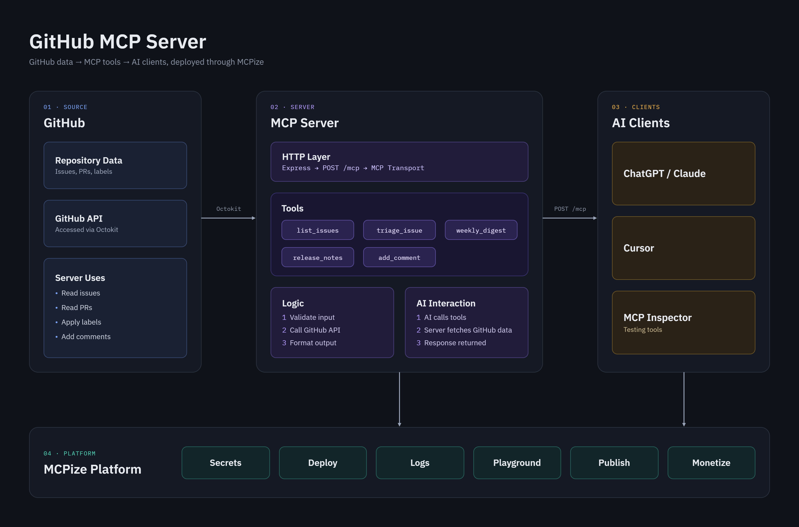

# GitHub Issue Tracker MCP Server



A small [Model Context Protocol](https://modelcontextprotocol.io/docs/getting-started/intro) server. It lets Cursor list GitHub issues, label them, post comments, and draft a weekly digest and release notes.

Almost all of the code is in `src/index.ts`. GitHub access uses `GITHUB_TOKEN`.

## What this server does

| Tool | What it does | Changes GitHub? |
|---|---|---|
| `list_issues` | Up to 10 issues. `state` is `open`, `closed`, or `all`. Pull requests are skipped. | No |
| `weekly_digest` | Count of issues updated in the last 7 days. | No |
| `release_notes` | Markdown from the last 10 merged pull requests. | No |
| `triage_issue` | Label `bug` if the title or body contains "bug", otherwise `enhancement`. | Yes |
| `add_comment` | Post a comment on an issue or pull request. | Yes |

## How it is built

| File | Role |
|---|---|
| `src/index.ts` | MCP server, five tools, Express routes |
| `package.json` | Dependencies and scripts |
| `tsconfig.json` | TypeScript (ES2022, NodeNext, strict) |
| `.env` | Local `GITHUB_TOKEN`. Never commit this file. |
| `.cursor/mcp.json` | URL Cursor uses to reach the server |
| `mcpize.yaml` | MCPize build and start commands |
| `Dockerfile` | Node 22 image, port 8080 |

The process listens on `PORT` (default `8080`).

- `GET /health` returns `{"status":"healthy"}`
- `POST /mcp` is the MCP endpoint
- `GET /mcp` returns **405**. That is expected. This server accepts `POST` only.

Dependencies, installed by `npm install`:

| Package | Used for |
|---|---|
| `@modelcontextprotocol/sdk` | MCP server and Streamable HTTP |
| `@octokit/rest` | GitHub API |
| `express` | `/health` and `/mcp` |
| `zod` | Tool input checks |
| `dotenv` | Loads `.env` |
| `chalk` | Startup logs |
| `typescript`, `tsx`, `@types/node`, `@types/express` | Build and `npm run dev` |

You need **Node.js 20+**.

## 1. Run it locally

```bash
npm install
```

Create a [fine-grained GitHub token](https://github.com/settings/tokens?type=beta):

- Repository access: only the repos this server should use
- **Issues:** Read and write
- **Pull requests:** Read-only
- **Metadata:** Read-only

Save it in `.env` in the project root. Do not commit it or paste it into chat.

```bash
GITHUB_TOKEN=github_pat_your_token_here
```

Start the server and leave the terminal open:

```bash
npm run dev
```

```text
MCP Server running on http://localhost:8080
  Health: http://localhost:8080/health
  MCP:    http://localhost:8080/mcp
```

`npm run build` compiles to `dist/`. `npm start` runs that build.

## 2. Connect Cursor

Cursor does not start this server. The process must already be running, locally or on MCPize.

Create `.cursor/mcp.json`:

```json
{
  "mcpServers": {
    "github-issue-tracker": {
      "url": "http://localhost:8080/mcp"
    }
  }
}
```

After deploy, point Cursor at the live server instead:

```json
{
  "mcpServers": {
    "github-issue-tracker": {
      "url": "https://mcp-server-for-github-issue-tracker.mcpize.run/mcp"
    }
  }
}
```

Use the `/mcp` path. The site root is not the MCP endpoint.

Then open **Cursor Settings → MCP**, turn on **github-issue-tracker**, and click **Reload**. The five tools should be enabled. If you use the live URL, you can stop `npm run dev`.

## 3. Test from Cursor

Reload the server in MCP settings, then paste one prompt into a new Agent chat.

Read-only:

```text
Use the github-issue-tracker list_issues tool for owner kaziashik and repo MCP-server-for-github-issue-tracker. Include open, closed, and all issues.
```

```text
Use the github-issue-tracker weekly_digest tool for owner kaziashik and repo MCP-server-for-github-issue-tracker.
```

```text
Use the github-issue-tracker release_notes tool for owner kaziashik and repo MCP-server-for-github-issue-tracker.
```

These two write to GitHub. Create a test issue first, then replace `1` with its number.

```text
Use the github-issue-tracker triage_issue tool for owner kaziashik, repo MCP-server-for-github-issue-tracker, and issue number 1.
```

```text
Use the github-issue-tracker add_comment tool for owner kaziashik, repo MCP-server-for-github-issue-tracker, and issue number 1. Comment body: MCP server test comment.
```

`No issues found.` or `No recent merged PRs found.` means the tool worked and the repo has nothing to show. A GitHub authentication error means the token is missing. Locally, fix `.env` and restart `npm run dev`. On MCPize, set the secret and deploy again.

## 4. Deploy on MCPize

`mcpize.yaml` already has the build and start commands.

```bash
npm install -g mcpize
mcpize login
mcpize secrets set GITHUB_TOKEN
mcpize deploy
```

`mcpize login` opens the browser. `mcpize secrets set GITHUB_TOKEN` asks for the token in the terminal. Then switch `.cursor/mcp.json` to the live URL in section 2 and reload Cursor.

| | |
|---|---|
| Gateway | https://mcp-server-for-github-issue-tracker.mcpize.run |
| Health | https://mcp-server-for-github-issue-tracker.mcpize.run/health |
| MCP | https://mcp-server-for-github-issue-tracker.mcpize.run/mcp |
| Marketplace | https://mcpize.com/mcp/mcp-server-for-github-issue-tracker |

Check a deployment with `mcpize status` and `mcpize logs`.
